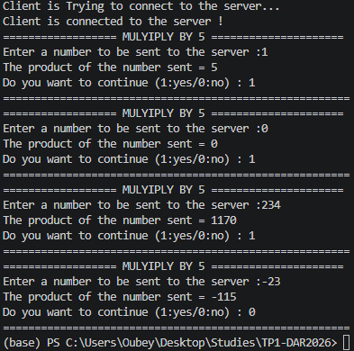
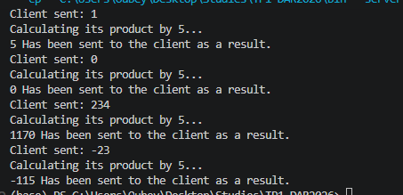

## Etape III 
Le socket serveur est online et attend un client pour se connecter.
---

---

## Etpae IV
Le client finallment est connecte au serveur par un socket serveur.

---

---

---

# Activite 1-2
le serveur fait tous le calcul le client recevoit le resulta et l affiche 

